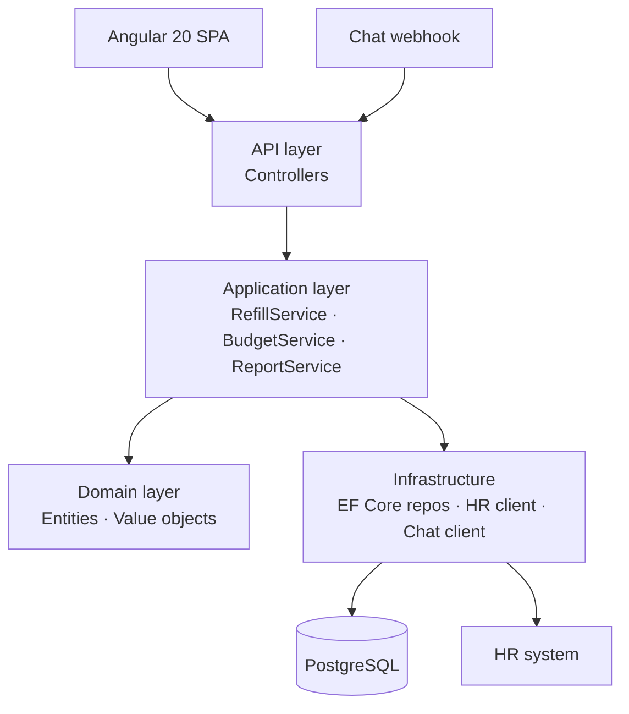
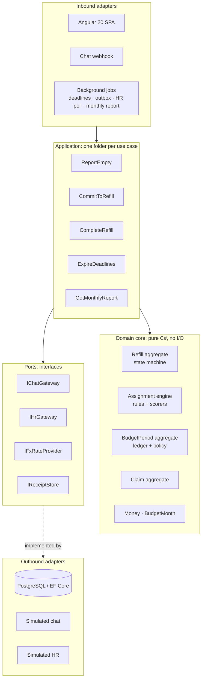
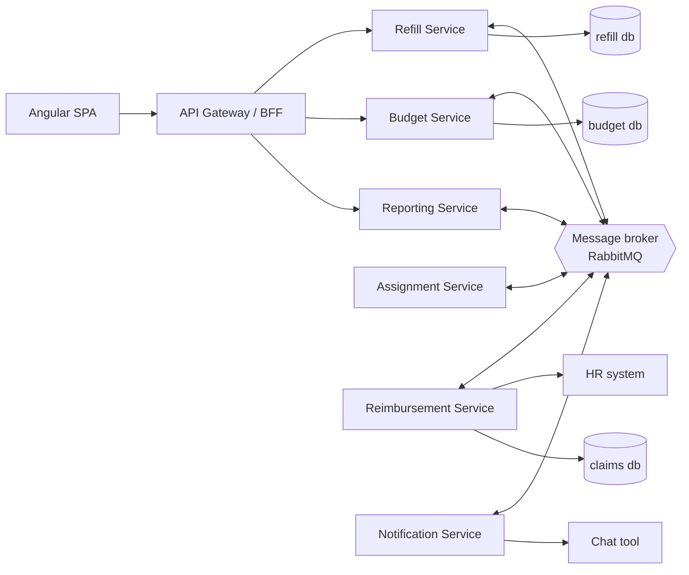

# Snack Counter Automation — Delivery Plan & Architecture Options

> **Stack:** .NET 10 · Angular 20 · PostgreSQL
> **Companion docs:** [01-HLD.md](01-HLD.md) (high-level design) · [02-LLD.md](02-LLD.md) (low-level design) · [03-DESIGN-DOC.md](03-DESIGN-DOC.md) (the 1–2 page deliverable)

---

## 1. What the interviewers are actually grading

| They say | What it really means | How this plan answers it |
|---|---|---|
| "You decide what *automate* means, justify it" | Product thinking, scoping | §2 maps each pain to a root cause and a mechanism; §6 says what we don't build |
| "Ask us anything" | Requirements discovery | §3 lists the questions, each with a fallback assumption |
| Working core logic: lifecycle, who buys, budget | Domain modelling, correctness | Rich domain core, explicit state machine, pluggable assignment and budget policies |
| Tests for the important rules | Testability, deterministic time, concurrency | Pure domain tests, `FakeTimeProvider`, a Postgres concurrency test |
| "Last 10 minutes: walk us through it" | Clarity, explainability | Small vocabulary, diagrams, a demo script (§10) |
| *Implicit:* "now change X" | Extensibility under pressure | §7 is a playbook: likely change → the one place it lands |

---

## 2. Problem → root cause → mechanism

| Pain | Root cause | Mechanism we build |
|---|---|---|
| Box sits empty for days | Nobody owns the refill ("someone else will do it") | Every refill has **exactly one owner at a time**: a directed offer with a deadline, automatic reassignment, then escalation |
| Two people buy on the same day | No shared state and no lock | **One active refill per counter**, enforced by the database. Committing is atomic (first one wins). Chat announces "Asha is on it" |
| A few people do most refills and wait weeks for money | No fairness, claims filed by hand | **Fairness scoring** (fewest recent refills first). People with **unpaid claims are skipped**. The **claim is sent to HR automatically** when the receipt is uploaded, and **overdue claims are tracked** |
| Nobody knows monthly spend or what gets eaten | No data | A **budget ledger** per office per month, a purchase record per refill, a **monthly consolidated report**, and consumption signals (days from refill to empty) |

---

## 3. Questions to ask first (with the assumption we use if there's no answer)

| # | Question | Default assumption |
|---|---|---|
| 1 | One snack box per office, or several? | One today. We model a `Counter` under `Office` so N boxes costs nothing later |
| 2 | Who can report "empty"? | Any employee, through chat, the web app, or a QR code on the box |
| 3 | Is the monthly budget a hard cap? What if it runs out mid-month? | Soft cap. New refills go **OnHold** when remaining < minimum purchase; overspend is flagged to the office admin |
| 4 | Does unused budget roll over? | No. It resets each month in the office's time zone |
| 5 | Which currency does management want the report in? | Configurable; default **NOK** |
| 6 | Which FX rate (monthly average, month-end, HR's rate)? | A monthly rate from an `IFxRateProvider`, **saved in the report** so the report can be reproduced |
| 7 | Can we read claim status from HR (poll or webhook)? Is submission idempotent? | A status endpoint we poll. We send our own reference as an idempotency key |
| 8 | Can visitors buy for the office they're visiting? | Yes, if they opt in. The visited office's budget pays, in that office's currency |
| 9 | What happens when HR rejects a claim? | The buyer is notified and can resubmit. The spend stays recorded |
| 10 | Is there an admin or coordinator per office? | Yes. They are the escalation target and budget owner |
| 11 | How fast should a volunteer answer an offer? | 2 hours (configurable) |
| 12 | Does the chat tool support DMs and buttons? | Yes. Fallback: a deep link into the web app |
| 13 | Where do employee ID, payroll currency and home office come from? | The company directory or HR. Stubbed with seed data |
| 14 | Would a company card be acceptable? | Out of scope, but worth raising: it removes reimbursement entirely |

---

## 4. Architecture options (pick one)

All three use the same domain model (§LLD-2). They differ in **how the code is organised and deployed**.

### Option A — Classic layered Clean Architecture (organised by technical layer)



- **Pros:** Familiar to everyone and fast to scaffold.
- **Cons:** Service classes grow with every feature (`RefillService` ends up with 15 methods). Adding a feature touches 4 folders. Logic tends to leak out of the domain into the services, leaving an anaemic model.
- **Best when:** The team is junior or the app is mostly CRUD.

### Option B — Modular monolith: hexagonal domain core + vertical slices ⭐ *Recommended*



- **Pros:**
  - Every rule lives in pure, fast-to-test domain code.
  - A new requirement usually means **a new slice or a new rule class**. Existing code isn't edited (open/closed principle).
  - Modules (Refills, Assignment, Budget, Reimbursement, Reporting) can be split into services later along the boundaries that already exist.
  - Small enough to explain in 10 minutes.
- **Cons:** More files than Option A. Needs discipline about dependency direction (enforced with an architecture test).
- **Best when:** The rules are business-heavy and requirements change. This is that case.

### Option C — Event-driven microservices



- **Pros:** Each part deploys and scales on its own. Shows you know distributed patterns (saga, outbox, eventual consistency).
- **Cons:** Massively overkill for **2 offices, ~35 volunteers and roughly 30 refills a month**. The **"two people can't commit" and budget rules become distributed-consistency problems** (sagas, compensation). It's slow to build, hard to test, and hard to demo.
- **Best when:** Many teams own parts of a system at large scale. Mention it in the interview as the *evolution path*, not the starting point.

### Trade-off matrix

| Criterion | A · Layered | **B · Modular monolith + slices** | C · Microservices |
|---|---|---|---|
| Time to working core + tests | ★★★★ | ★★★★ | ★ |
| Testability of business rules | ★★★ | ★★★★★ | ★★ |
| Absorbing "change X" tweaks | ★★ | ★★★★★ | ★★★ |
| Correctness under concurrency | ★★★★ (single DB) | ★★★★★ (single DB + aggregates) | ★★ (distributed) |
| Explainable in 10 min | ★★★★ | ★★★★ | ★★ |
| Operational complexity | Low | Low | High |
| Fits the actual scale | Yes | Yes | No |

**Recommendation: Option B.** Present C as "how this would grow" and A as "what I deliberately didn't do, and why".

---

## 5. Secondary design decisions (pick one in each row)

| Decision | Option 1 ⭐ (recommended) | Option 2 | Option 3 |
|---|---|---|---|
| **D1: How a buyer is chosen** | **Directed offers**: offer to the best-scored candidate. On decline or timeout, offer to the next one. After N tries, broadcast to everyone eligible (first to commit wins) | Broadcast only, first come first served (simple, but unfair: the same keen people always win) | Weekly rota or "snack captain" (predictable, but breaks with hybrid work and holidays). *Can be added as a scorer later* |
| **D2: How the process is orchestrated** | **State machine inside the aggregate + deadline columns + one sweeper job** (`deadline_utc <= now`) | Saga / process manager with scheduled messages (Wolverine, MassTransit) | Workflow engine (Temporal, Elsa). Strong for long workflows, but heavy |
| **D3: How the budget is enforced** | **Reserve at commit + soft cap**: reserve the expected amount at commit, block new refills below the minimum, flag overspend to the admin | Hard cap: reject any receipt that goes over budget (unfair to a volunteer who has already paid) | Report-only: no enforcement, just visibility |
| **D4: Refill vs money** | **Two aggregates**: `Refill` (is the box full?) and `Claim` (is the volunteer paid?), linked by ID. A new refill can start while the last claim is still pending | One big `Refill` that runs all the way to *Reimbursed*. Simpler diagram, but locks the counter for up to 10 days or mixes two lifecycles | — |
| **D5: Mediator / handlers** | **Plain `ICommandHandler<T>` interfaces + a tiny dispatcher + decorators** (no licence issues, nothing hidden) | MediatR (commercial licence since v13) | Wolverine (also adds messaging and the outbox) |
| **D6: Angular state** | **Signals-based feature stores** (`signal`, `computed`) | NgRx Signal Store | NgRx classic store (overkill) |

---

## 6. What we deliberately won't build (YAGNI, and say so in the interview)

- **Real HR and chat integrations.** Simulated adapters behind ports. The brief asks for exactly this.
- **Receipt OCR.** The buyer types the amount and the receipt image is attached. The HR approver checks it anyway.
- **Item-level inventory, IoT weight sensors, auto-ordering.** A sensor could call the same `ReportEmpty` command later.
- **Our own FX feed.** One provider interface, with fixed rates in the demo.
- **Our own login system.** Company SSO (OIDC) in production. A dev "act as user" header for the demo.
- **Microservices, Kubernetes, message broker.** Not justified at this scale.
- **Mobile app.** Chat plus a responsive web app covers it.
- **Snack voting or preferences.** A possible module later. Phase 1 only captures optional purchase items.

---

## 7. Extensibility playbook: "the interviewer changes X"

| Likely tweak | Where it lands | Existing code changed? |
|---|---|---|
| Add a 3rd office (London, GBP) | Insert rows into `offices` + `office_budget_periods`. `Currency` is data, not an enum | No |
| Several boxes per office | Already modelled: `Counter` belongs to `Office`; the unique-active index is per counter | No |
| Change the "who buys" rule (round-robin, rota, seniority…) | New `IScoringRule` / `IEligibilityRule` class + DI registration + config weight | No |
| Visitors may not buy | Remove or disable the `VisitorEligibility` rule (config flag) | No |
| Quarterly instead of monthly budget | `IBudgetPeriodCalculator` strategy (`BudgetMonth` → `BudgetPeriodKey`) | One place |
| Hard cap instead of soft | `HardCapBudgetPolicy : IBudgetPolicy` | No |
| Admin approval for overspend | `IBudgetPolicy` returns `RequiresApproval` → new `AwaitingApproval` state + `ApproveOverspend` slice | Transition table + new slice |
| Company card instead of reimbursement | `IPaymentMethod` strategy: `CompanyCard` skips creating a `Claim` | One handler |
| Slack/Teams instead of the internal chat | New `IChatGateway` adapter | No |
| HR webhook instead of polling | New inbound endpoint calls the existing `UpdateClaimStatus` command | No |
| "I already refilled it" with no report | New `RecordSpontaneousRefill` slice = Report + Commit + Complete in one transaction | No |
| Split a purchase between two people | `Purchase` → `Contributions[]`, one claim per contributor | Moderate (domain) |
| Weekly report / Slack digest | New query + scheduled job | No |
| Take working hours into account in deadlines | `IDeadlineCalculator` strategy (office calendar) | One place |
| Auto-detect empty with a sensor | New inbound adapter → `ReportEmpty` | No |

---

## 8. Coding principles → concrete choices

| Principle / pattern | Where it shows up |
|---|---|
| **SRP** | One handler per use case. Each assignment rule is its own class. Adapters only translate |
| **OCP** | Assignment rules and scorers, `IBudgetPolicy`, `IChatGateway`, `IHrGateway` are extended by adding classes |
| **LSP** | Simulated and real adapters fulfil the same contract; contract tests run against both |
| **ISP** | Small ports (`IHrGateway` has 2 methods) instead of one "IntegrationService" |
| **DIP** | Domain depends on nothing. Application depends on ports. Infrastructure implements them |
| **State pattern / transition table** | `Refill` and `Claim` lifecycles. Illegal transitions are impossible |
| **Strategy + Specification + Pipeline** | Assignment engine: filters → scorers → tie-break |
| **Value objects** | `Money` (never adds across currencies), `BudgetMonth`, strongly typed IDs |
| **Aggregate + Repository + Unit of Work** | `Refill`, `BudgetPeriod`, `Claim`. EF `DbContext` is the unit of work |
| **Domain events + transactional outbox** | Side effects (chat, HR) are sent only after commit, reliably |
| **Adapter / anti-corruption layer** | The HR and chat models never leak into the domain |
| **Decorator** | Logging, validation and transaction behaviour around handlers |
| **Result pattern** | Expected failures (`AlreadyTaken`, `BudgetExhausted`) are values. Exceptions are for bugs |
| **Explicit time** | `TimeProvider` everywhere. Tests use `FakeTimeProvider` |
| **KISS / YAGNI** | §6. One deployable, one database, background jobs instead of a broker |

---

## 9. Delivery roadmap (core first, so it's demo-able at every step)

| Phase | Scope | Exit criteria |
|---|---|---|
| **P0: Domain core** (must) | `Money`, `BudgetMonth`, `Refill` state machine, `AssignmentEngine` + default rules, `BudgetPeriod` + policy, `Claim` | `dotnet test` green, all rule tests from LLD §14 pass, no I/O |
| **P1: Application + simulators** (must) | Command handlers, in-memory repos, `SimulatedChatGateway`, `SimulatedHrGateway`, `DeadlineSweeper` logic | Scenario tests: empty → reimbursed and timeout → reassign, run with `FakeTimeProvider` |
| **P2: Persistence + API** | EF Core 10 + Npgsql, migrations, partial unique index, `xmin` concurrency, outbox, Minimal APIs, ProblemDetails | Testcontainers test: 2 concurrent commits → exactly 1 succeeds |
| **P3: Angular 20 UI** | Dashboard, refill detail (commit, decline, upload receipt), availability, budget, monthly report, **dev panel** (chat feed, HR approve/reject, clock advance) | Full lifecycle clickable end to end |
| **P4: Polish** | Hosted jobs, monthly report job, docker-compose, seed data, architecture tests | `docker compose up` → working demo |
| **Doc** | [03-DESIGN-DOC.md](03-DESIGN-DOC.md) finalised (≤ 2 pages) | Reviewed against the brief's 4 bullet points |

> If time is short, **P0 + P1 + design doc** already meets the brief ("working core logic with simulated stand-ins + tests"). P2–P4 are bonus.

---

## 10. Ten-minute walkthrough script

1. **(1 min) Problem → mechanism table** (§2). Frame "automate" as *ownership, exclusivity, fairness, visibility*.
2. **(2 min) Lifecycle diagram** (HLD §5): empty → offered → committed → completed → claim → reimbursed. Point out the two aggregates.
3. **(2 min) Code tour:** `Refill.Commit` (guarded transition), `AssignmentEngine` (filters + scorers), `BudgetPeriod.Reserve/Spend`.
4. **(2 min) Tests:** concurrency test, timeout-reassign test with `FakeTimeProvider`, two-currency report test.
5. **(2 min) Live demo** with the dev panel: report empty → offer appears in the simulated chat → let it time out → reassigned → commit → upload receipt → HR approve → report.
6. **(1 min) Trade-offs and what I didn't build** (§6). Then the "change X" table (§7) to show you're ready for tweaks.

---

## 11. Solution layout (Option B)

```
snack-counter/
├─ src/
│  ├─ SnackCounter.Domain/          # pure C#, zero package references
│  ├─ SnackCounter.Application/     # use-case slices, ports, decorators
│  ├─ SnackCounter.Infrastructure/  # EF Core, outbox, adapters, jobs
│  └─ SnackCounter.Api/             # Minimal APIs, auth, webhooks, DI composition root
├─ tests/
│  ├─ SnackCounter.Domain.Tests/        # fast unit tests (most tests live here)
│  ├─ SnackCounter.Application.Tests/   # scenario tests with fakes + FakeTimeProvider
│  ├─ SnackCounter.Integration.Tests/   # Testcontainers PostgreSQL, API tests
│  └─ SnackCounter.Architecture.Tests/  # dependency-direction rules
├─ web/snack-counter-ui/            # Angular 20
├─ docs/                            # these documents
└─ docker-compose.yml               # postgres + api + ui
```

---

## 12. Your decisions

Answer these and I'll start P0:

1. **Architecture:** A / **B (recommended)** / C
2. **D1 Assignment:** **Directed + broadcast fallback** / Broadcast only / Rota
3. **D2 Orchestration:** **Aggregate state machine + sweeper** / Saga / Workflow engine
4. **D3 Budget:** **Reserve + soft cap** / Hard cap / Report-only
5. **D4 Aggregates:** **Refill + Claim separate** / Single Refill
6. **D5 Handlers:** **Custom dispatcher** / MediatR / Wolverine
7. **D6 Angular state:** **Signal stores** / NgRx Signal Store
8. **Reporting currency:** **NOK** / EUR / other
