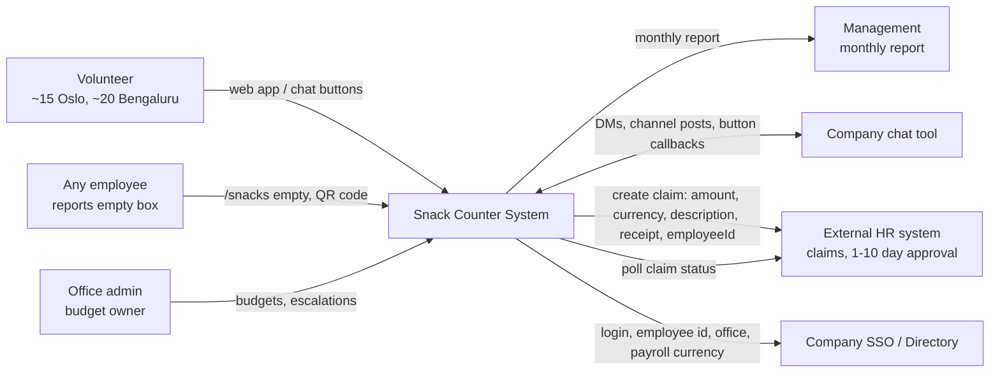
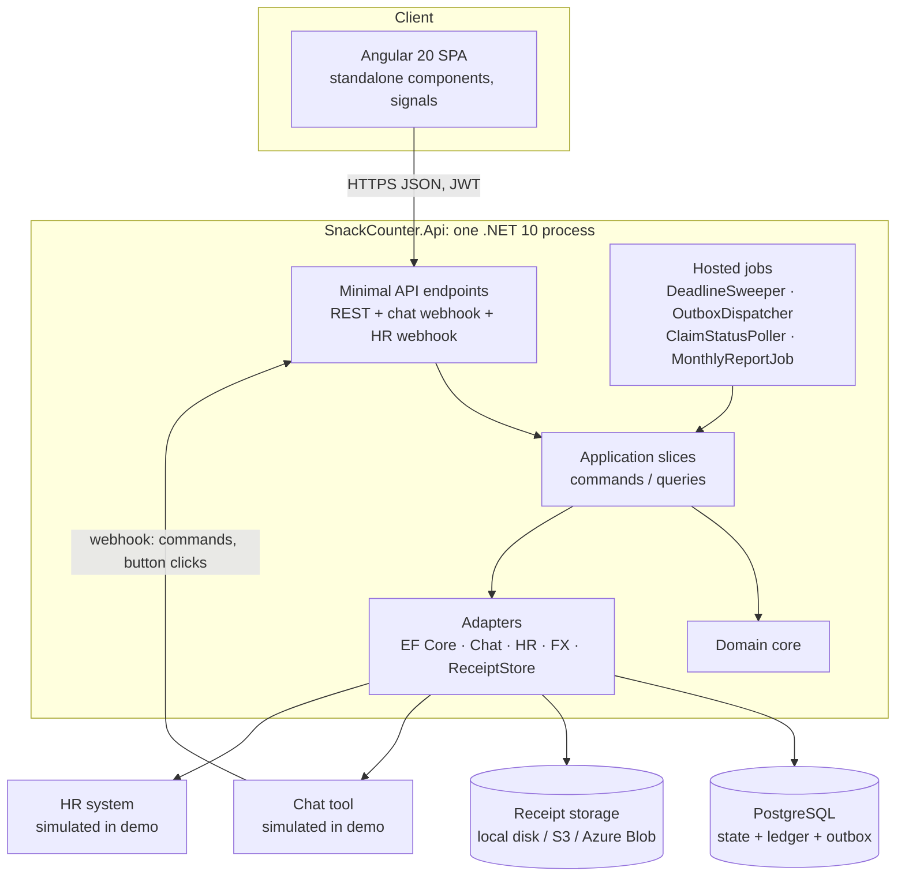
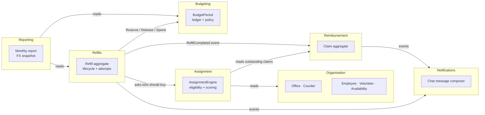
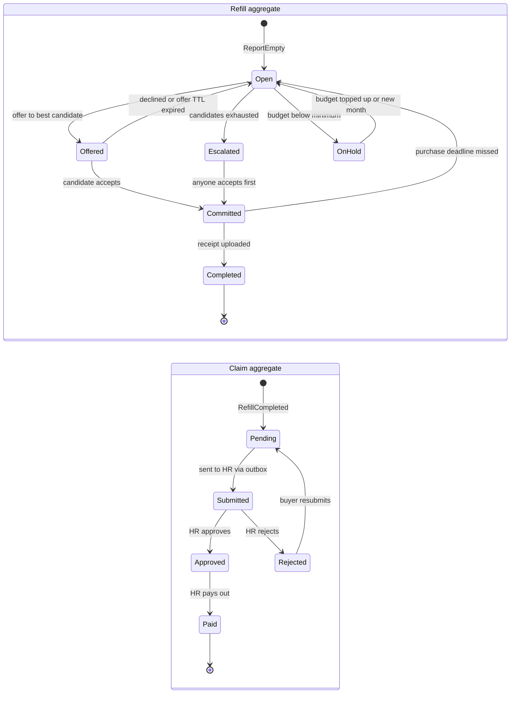
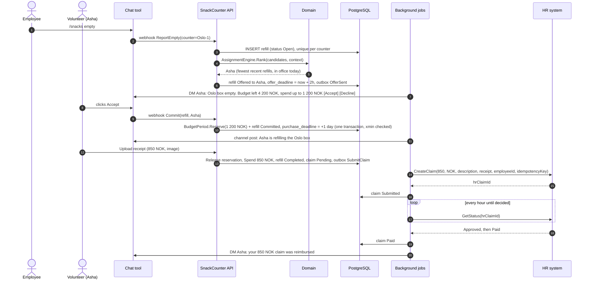
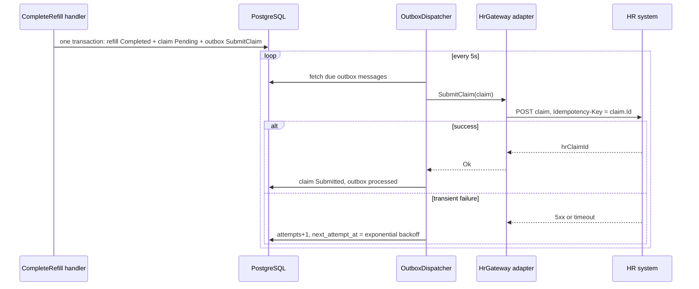
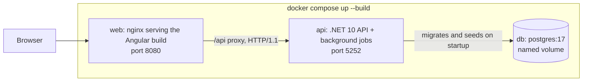

# Snack Counter Automation — High-Level Design (HLD)

> Assumes **Option B**: a modular monolith with a hexagonal core and vertical slices. See [00-PLAN.md](00-PLAN.md) for the alternatives.
> Details: [02-LLD.md](02-LLD.md)

---

## 1. Scope and quality attributes

**In scope:** reporting an empty box, choosing a buyer, offers, deadlines, reassignment, the budget check, recording the purchase, submitting the reimbursement claim and tracking it, the monthly consolidated report, availability (holiday, remote, visiting another office).

| Quality attribute | Target | How |
|---|---|---|
| **Correctness under concurrency** | Never two active refills for one counter. Never two owners of one refill | DB partial unique index + optimistic concurrency (`xmin`) + domain guards |
| **Reliability of side effects** | No lost or duplicated HR claims or chat messages | Transactional outbox + idempotency keys + retries |
| **Timeliness** | A refill is never ownerless for longer than the offer TTL | Deadline columns + a sweeper job running every minute |
| **Auditability** | Every euro, krone and rupee can be traced | Append-only budget ledger + refill event history |
| **Testability** | Every rule testable with no I/O and no wall clock | Pure domain + `TimeProvider` |
| **Scale** | ~2 counters, ~35 volunteers, ~30 refills a month | A single small instance is plenty. A second instance is safe: row-version checks plus idempotent HR submission (worst case, a duplicate chat message) |
| **Security** | Company SSO. Office-admin role for budgets. Receipts private | OIDC JWT, role-based policies, private blob store |

---

## 2. System context

---

## 3. Containers

**Why one process?** At this scale a broker adds failure modes and adds nothing. The outbox table works as a durable queue inside Postgres. If we ever needed a broker, only the `OutboxDispatcher` would change.

---

## 4. Modules (bounded contexts) inside the monolith

Modules talk through **application services or domain events** and never touch each other's tables. That keeps the option of splitting into services later (Option C) open.

---

## 5. End to end: from "empty" to "reimbursed"

### 5.1 Lifecycle (both aggregates)

> Any non-terminal refill state → `Cancelled` (admin only). Left off the diagram to keep it readable.

### 5.2 Happy path sequence

### 5.3 Unhappy paths (the rules the tests must prove)

| Scenario | System behaviour |
|---|---|
| Second person reports "empty" | The partial unique index rejects a second active refill. The handler returns the existing one: "Already reported, Asha is on it." |
| Two volunteers press **Accept** at the same instant | Both load version *v*. The first `UPDATE … WHERE xmin = v` wins. The second gets a concurrency conflict → `409 AlreadyTaken`. Chat: "Thanks! Asha already took it." |
| Offer not answered within the TTL | The sweeper sees `offer_deadline <= now` → the attempt is recorded as `Expired` → the next candidate gets the offer |
| N directed offers fail | The refill moves to `Escalated`: broadcast to all eligible volunteers + ping the office admin. First commit wins |
| Committed buyer doesn't buy by the deadline | Reminder at 50% of the window. At the deadline: reservation released, refill back to `Open`, person excluded, next candidate |
| Late receipt from the previous owner (nobody else has committed yet) | Accepted as a *late completion*: the buyer paid real money, so we never strand it |
| Budget remaining < minimum purchase | Refill → `OnHold`. Admin notified. It resumes when the admin tops up or the new month starts |
| Receipt is over the remaining budget | Soft cap: spend recorded, `OverBudget` flag, admin notified. The claim still goes to HR |
| HR is down | The outbox keeps retrying with backoff. The idempotency key prevents a duplicate claim |
| Claim undecided after 10 days | Marked `Overdue`. The admin is told to chase HR. The buyer is deprioritised until it's paid (fairness) |
| Volunteer is on holiday or working from home | Excluded by the presence rule (availability entries + default office days) |
| Bengaluru volunteer visiting Oslo | Eligible for the **Oslo** counter while visiting (opt-in). Spend is charged to Oslo's NOK budget, the claim is in NOK, HR pays in INR |

---

## 6. The main parts and the data each keeps

| Part | Responsibility | Data it owns |
|---|---|---|
| **Organisation** | Offices, counters, people, presence | `offices` (currency, time zone, typical min/max purchase), `counters`, `employees` (HR id, chat id, home office, payroll currency), `volunteer_memberships`, `availability` |
| **Refills** | Lifecycle, ownership, deadlines | `refills` (status, assignee, deadlines, version), `assignment_attempts` (who was offered, response, timestamps), `purchases` (amount, currency, receipt key, optional items), `refill_events` (audit) |
| **Assignment** | Choosing who buys (stateless) | Owns no tables. Reads a projection of candidates. Config: weights, TTLs, caps |
| **Budgeting** | Budget check, reservations, spend | `office_budget_periods` (office, month, limit, version), `budget_ledger_entries` (Reserve / Release / Spend / Adjust) |
| **Reimbursement** | HR claim lifecycle | `claims` (employee, amount, currency, status, hr_claim_id, idempotency key, submitted/decided at) |
| **Reporting** | Monthly consolidated spend | `fx_rates` (month, from, to, rate), `monthly_reports` (snapshot JSON, rates used) |
| **Infrastructure** | Reliable side effects | `outbox_messages` (type, payload, attempts, next_attempt_at, processed_at) |

---

## 7. Integration design

### 7.1 Chat tool (inbound and outbound)

- **Outbound** (`IChatGateway`): `Send(audience, message)`, where the audience is a person (DM), an office channel, or the office admins, and the message can carry buttons.
- **Inbound** webhook `/api/integrations/chat/events`: slash commands (`/snacks empty | status | away 20.11-27.11 | visiting oslo 20.11-27.11`) and button callbacks (`accept:{refillId}`, `decline:{refillId}`). Each is translated into the **same application command** the web UI uses, so there's a single source of truth.
- **Demo:** `SimulatedChatGateway` keeps messages in a table. The Angular **dev panel** shows them with clickable buttons.

### 7.2 HR system (anti-corruption layer)

- The domain never sees HR's DTOs. The adapter maps `Claim` to HR's format and HR statuses back to our `ClaimStatus`.
- Resilience: `Microsoft.Extensions.Http.Resilience` (retry, timeout, circuit breaker) inside the adapter. The outbox handles longer outages.

### 7.3 Identity

- OIDC (company SSO) → JWT with `employee_id`. Roles: `Volunteer`, `OfficeAdmin`, `Management`.
- Dev mode: an `X-Act-As` header so the demo can switch users. Only registered in the `Development` environment.

---

## 8. Background jobs

| Job | Interval | Does |
|---|---|---|
| `DeadlineSweeper` | 1 min | Expires offers → re-offer. Purchase-deadline reminders and releases. Escalation pings |
| `OutboxDispatcher` | 5 s | Delivers chat messages and HR submissions with retry and backoff |
| `ClaimStatusPoller` | 1 h | Polls HR for `Submitted` claims. Flags `Overdue` after 10 days |
| `MonthlyReportJob` | 1st of month, 08:00 Europe/Oslo | Builds the report for the previous month, snapshots FX rates, sends it to management. Resumes `OnHold` refills |

All jobs are one generic `PeriodicCommandJob` (`BackgroundService` + `PeriodicTimer`) that dispatches an ordinary, tested application command in a fresh scope. The jobs hold no logic of their own. If two instances race on the same row, the `xmin` row-version check makes one fail cleanly, and the next tick re-reads. (`SKIP LOCKED` inside an explicit transaction is the upgrade path. Quartz.NET or Hangfire is a drop-in if we want cron syntax and a dashboard.)

---

## 9. Cross-cutting concerns

| Concern | Decision |
|---|---|
| **Money** | `decimal` + ISO currency code (`numeric(12,2)` + `char(3)` in the DB). `Money` throws if you add different currencies. Each office's budget is in its own currency. Conversion happens **only in reporting**, using a saved rate |
| **Time** | Store UTC (`timestamptz`). Budget month = purchase time in the **office's** time zone (`Europe/Oslo`, `Asia/Kolkata`). Inject `TimeProvider` everywhere |
| **Errors** | Domain returns `Result`. API maps errors to RFC 7807 ProblemDetails (`409` AlreadyTaken / InvalidTransition, `422` BudgetExhausted, `404`, `400`) |
| **Observability** | Structured logging (correlation id = refill id), OpenTelemetry traces and metrics: time to refill, offers per refill, claim age |
| **Validation** | Minimal API built-in validation / FluentValidation at the edge. Invariants in the domain |
| **Privacy** | Receipts in private storage, served only to the owner, the admin and the HR adapter. Retention policy configurable |

---

## 10. Deployment

*As built in P4:* `web` serves the static Angular build and reverse-proxies `/api`, so the browser sees one origin and needs no CORS. `api` is a multi-stage .NET image running as the non-root user from the base image. It applies EF migrations and seeds demo data on startup, and runs the background jobs in-process. Demo controls are on (`DevTools__Enabled`) and should be turned off for a real deployment.

**Known demo limitation:** receipts are held in memory by `InMemoryReceiptStore`, so they're lost when the API container restarts (claims and money are in PostgreSQL). Production swaps in a blob-storage `IReceiptStore`, which is one adapter class.

Production would be the same shape: one container (or 2 replicas) for the API, managed PostgreSQL, object storage for receipts, and the real chat and HR adapters chosen by configuration.

---

## 11. How each original problem is prevented

| Problem | Prevention | Proven by test |
|---|---|---|
| Box empty for days | One owner at a time, offer TTL, purchase deadline, auto-reassign, escalation | `UnansweredOffer_IsReofferedToNextCandidate`, `MissedPurchaseDeadline_ReassignsAndReleasesBudget` |
| Two buy the same day | One active refill per counter (DB) + atomic commit | `TwoConcurrentCommits_OnlyOneSucceeds`, `SecondEmptyReport_ReturnsExistingRefill` |
| Few do most, wait weeks | Fairness scoring, outstanding-claim cap, automatic HR submission, overdue escalation | `PrefersVolunteerWithFewestRecentRefills`, `SkipsVolunteerWithTooManyUnpaidClaims`, `ClaimSubmittedOnceDespiteRetries` |
| No spending visibility | Ledger + monthly consolidated report with saved FX | `MonthlyReport_TotalsAcrossCurrencies`, `BudgetRemaining_IsLimitMinusSpendMinusReservations` |
