# Snack Counter Automation — Low-Level Design (LLD)

> Builds on [01-HLD.md](01-HLD.md). Assumes the recommended decisions in [00-PLAN.md §5](00-PLAN.md).

---

## 1. Solution structure

### 1.1 Backend (.NET 10)

```
src/
├─ SnackCounter.Domain/                     # no package references
│  ├─ Common/          Entity, AggregateRoot, IDomainEvent, Result, Error, Money, Currency, BudgetMonth, StronglyTypedIds
│  ├─ Organisation/    Office, Counter, Employee, Availability, PresenceResolver
│  ├─ Refills/         Refill, RefillStatus, RefillTransitions, AssignmentAttempt, Purchase, RefillErrors, Events/
│  ├─ Assignment/      AssignmentEngine, Candidate, AssignmentContext, IEligibilityRule, IScoringRule, Rules/, Scorers/
│  ├─ Budgeting/       BudgetPeriod, LedgerEntry, IBudgetPolicy, SoftCapBudgetPolicy, BudgetErrors
│  └─ Reimbursement/   Claim, ClaimStatus, ClaimErrors, Events/
├─ SnackCounter.Application/
│  ├─ Abstractions/    ICommandHandler<TCmd,TRes>, IQueryHandler<TQ,TRes>, IDispatcher, IUnitOfWork
│  ├─ Ports/           IChatGateway, IHrGateway, IFxRateProvider, IReceiptStore, ICandidateReader, repositories
│  ├─ Behaviors/       LoggingDecorator, ValidationDecorator, TransactionDecorator
│  └─ Features/
│     ├─ Refills/      ReportEmpty/, OfferNext/, Commit/, Decline/, Complete/, Cancel/, SweepDeadlines/, GetRefill/, ListRefills/
│     ├─ Availability/ SetAvailability/, GetMyAvailability/
│     ├─ Budget/       SetMonthlyLimit/, GetBudgetStatus/
│     ├─ Claims/       SubmitClaim/, SyncClaimStatus/, GetMyClaims/
│     ├─ Reports/      GetMonthlyReport/, GenerateMonthlyReport/
│     └─ Chat/         HandleChatEvent/   (translates chat → the commands above)
├─ SnackCounter.Infrastructure/
│  ├─ Persistence/     SnackDbContext, Configurations/, Migrations/, Repositories/, Outbox/
│  ├─ Integrations/    Chat/(Simulated, Http), Hr/(Simulated, Http), Fx/(ConfigFxRateProvider), Receipts/(LocalDisk)
│  └─ Jobs/            DeadlineSweeperJob, OutboxDispatcherJob, ClaimStatusPollerJob, MonthlyReportJob
└─ SnackCounter.Api/
   ├─ Endpoints/       RefillEndpoints, BudgetEndpoints, ReportEndpoints, AvailabilityEndpoints, IntegrationEndpoints, DevEndpoints
   ├─ ErrorHandling/   ResultToProblemDetails
   └─ Program.cs       composition root
```

Each **feature folder** holds `Command.cs`, `Handler.cs`, `Validator.cs` and optionally `Endpoint.cs`. Adding a use case means adding a folder.

**Packages:** `Npgsql.EntityFrameworkCore.PostgreSQL`, `FluentValidation`, `Microsoft.Extensions.Http.Resilience`, `Scrutor` (decorator registration).
**Test packages:** `xUnit`, `Shouldly` (or AwesomeAssertions), `NSubstitute`, `Microsoft.Extensions.TimeProvider.Testing`, `Testcontainers.PostgreSql`, `NetArchTest.Rules`.
*(We avoid MediatR, AutoMapper and FluentAssertions v8+ because their licences are now commercial.)*

### 1.2 Dependency rule (checked by an architecture test)

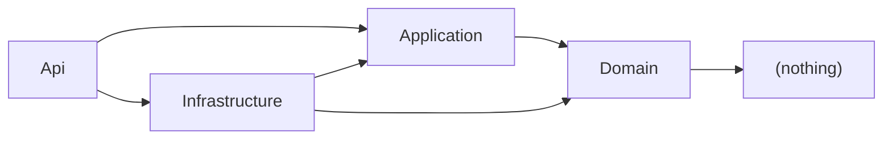

---

## 2. Domain model

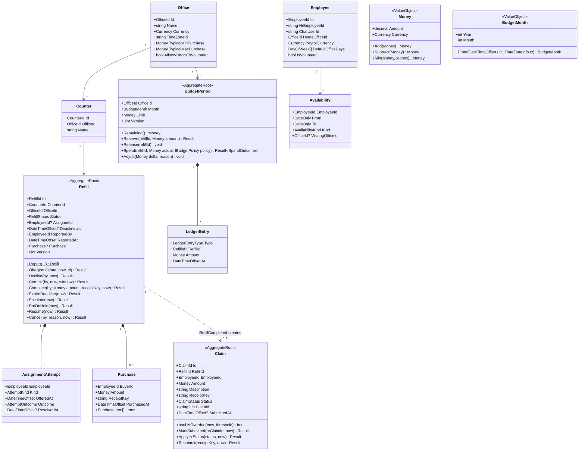

### 2.1 Enums

| Enum | Values |
|---|---|
| `RefillStatus` | `Open`, `Offered`, `Escalated`, `OnHold`, `Committed`, `Completed`, `Cancelled` |
| `AttemptKind` | `DirectedOffer`, `Broadcast` |
| `AttemptOutcome` | `Pending`, `Accepted`, `Declined`, `OfferExpired`, `PurchaseDeadlineMissed`, `Superseded` |
| `AvailabilityKind` | `Holiday`, `Remote`, `AtOffice` (with `VisitingOfficeId` when it isn't the home office) |
| `LedgerEntryType` | `Reserve`, `Release`, `Spend`, `Adjust` |
| `ClaimStatus` | `Pending`, `Submitted`, `Approved`, `Rejected`, `Paid` |

---

## 3. Value objects and their rules

### 3.1 `Money`

```csharp
public readonly record struct Currency(string Code)            // "NOK", "INR". Data, not an enum, so new offices need no code change
{
    public static Currency Of(string code) =>
        code is { Length: 3 } && code.All(char.IsAsciiLetterUpper)
            ? new(code) : throw new ArgumentException($"Invalid ISO currency '{code}'");
}

public readonly record struct Money(decimal Amount, Currency Currency)
{
    public static Money Zero(Currency c) => new(0m, c);

    public Money Add(Money other)      { EnsureSame(other); return this with { Amount = Amount + other.Amount }; }
    public Money Subtract(Money other) { EnsureSame(other); return this with { Amount = Amount - other.Amount }; }
    public static Money Min(Money a, Money b) { a.EnsureSame(b); return a.Amount <= b.Amount ? a : b; }
    public bool IsLessThan(Money other) { EnsureSame(other); return Amount < other.Amount; }

    public Money ConvertTo(Currency target, decimal rate) =>     // used ONLY by reporting
        new(decimal.Round(Amount * rate, 2, MidpointRounding.AwayFromZero), target);

    private void EnsureSame(Money o)
    {
        if (o.Currency != Currency)
            throw new CurrencyMismatchException(Currency, o.Currency);  // mixing currencies is a programming error
    }
}
```

### 3.2 `BudgetMonth`

The month is computed from the purchase instant in the **office's** time zone. 23:30 on 31 Oct in Oslo counts toward October even though it's already 1 Nov somewhere else.

```csharp
public readonly record struct BudgetMonth(int Year, int Month)
{
    public static BudgetMonth From(DateTimeOffset utc, TimeZoneInfo officeTz)
    {
        var local = TimeZoneInfo.ConvertTime(utc, officeTz);
        return new(local.Year, local.Month);
    }
    public override string ToString() => $"{Year:D4}-{Month:D2}";
}
```

---

## 4. Refill state machine

### 4.1 Diagram

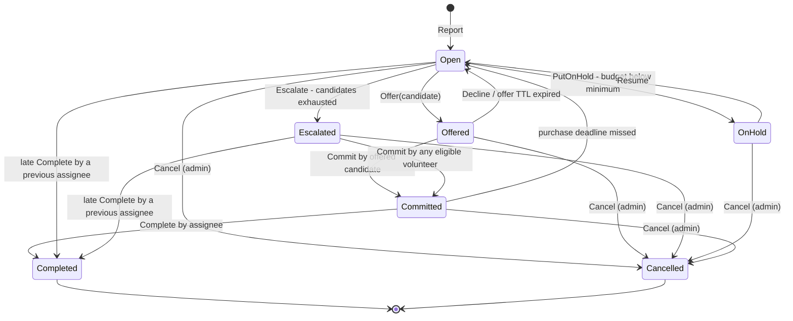

### 4.2 Transition table (the single source of truth)

| From | Trigger | Guard | To | Side effects (domain events) |
|---|---|---|---|---|
| — | `Report` | No active refill for this counter (DB index) | `Open` | `RefillReported` |
| `Open` | `Offer(c)` | `c` not already attempted on this refill | `Offered` | `RefillOffered(c, deadline)` |
| `Open` | `Escalate` | Directed attempts ≥ `MaxDirectedOffers`, or no candidates | `Escalated` | `RefillEscalated` |
| `Open` | `PutOnHold` | `budget.Remaining < office.TypicalMinPurchase` | `OnHold` | `RefillOnHold` |
| `OnHold` | `Resume` | Budget topped up or new month | `Open` | `RefillResumed` |
| `Offered` | `Decline(by)` | `by == Assignee` | `Open` | `OfferDeclined` |
| `Offered` | `ExpireDeadline` | `now >= DeadlineUtc` | `Open` | `OfferExpired` |
| `Offered` | `Commit(by)` | `by == Assignee` | `Committed` | `RefillCommitted` → reserve budget |
| `Escalated` | `Commit(by)` | `by` is eligible (checked by the handler) | `Committed` | `RefillCommitted` → reserve budget |
| `Committed` | `Commit(by)` | `by == Assignee` | `Committed` | *(idempotent no-op)* |
| `Committed` | `Commit(by)` | `by != Assignee` | ✖ | `Error: AlreadyTaken(assignee)` |
| `Committed` | `ExpireDeadline` | `now >= DeadlineUtc` | `Open` | `PurchaseDeadlineMissed` → release budget |
| `Committed` | `Complete(by, amount)` | `by == Assignee`, `amount.Currency == office.Currency`, `amount > 0` | `Completed` | `RefillCompleted` → spend budget, create claim |
| `Open`/`Offered`/`Escalated`/`OnHold` | `Complete(by, amount)` | `by` previously attempted with outcome `PurchaseDeadlineMissed` (late completion; any pending offer is superseded) | `Completed` | `RefillCompleted(late: true)` |
| non-terminal | `Cancel(admin)` | Caller has the `OfficeAdmin` role | `Cancelled` | `RefillCancelled` → release budget |

Implementation: one static `RefillTransitions` map, `(RefillStatus from, RefillTrigger trigger) → RefillStatus to`, checked by a private `TransitionTo(trigger)`. **Guards live in the aggregate methods.** Any combination not in the map returns `InvalidTransition`.

### 4.3 Core aggregate code (abridged)

```csharp
public sealed class Refill : AggregateRoot<RefillId>
{
    private readonly List<AssignmentAttempt> _attempts = [];
    public CounterId CounterId { get; private set; }
    public OfficeId OfficeId { get; private set; }
    public RefillStatus Status { get; private set; }
    public EmployeeId? AssigneeId { get; private set; }
    public DateTimeOffset? DeadlineUtc { get; private set; }
    public Purchase? Purchase { get; private set; }
    public IReadOnlyList<AssignmentAttempt> Attempts => _attempts;
    public uint Version { get; private set; }                     // mapped to PostgreSQL xmin

    public static Refill Report(CounterId counter, OfficeId office, EmployeeId reporter, DateTimeOffset now)
    {
        var r = new Refill { Id = RefillId.New(), CounterId = counter, OfficeId = office, Status = RefillStatus.Open };
        r.Raise(new RefillReported(r.Id, counter, reporter, now));
        return r;
    }

    public Result Offer(EmployeeId candidate, DateTimeOffset now, TimeSpan ttl)
    {
        if (_attempts.Any(a => a.EmployeeId == candidate)) return RefillErrors.AlreadyAttempted(candidate);
        return TransitionTo(RefillTrigger.Offer).Then(() =>
        {
            AssigneeId = candidate; DeadlineUtc = now + ttl;
            _attempts.Add(AssignmentAttempt.Directed(candidate, now));
            Raise(new RefillOffered(Id, candidate, DeadlineUtc.Value));
        });
    }

    public Result Commit(EmployeeId by, DateTimeOffset now, TimeSpan purchaseWindow)
    {
        if (Status == RefillStatus.Committed)
            return by == AssigneeId ? Result.Ok() : RefillErrors.AlreadyTaken(AssigneeId!.Value);

        var allowed = Status switch
        {
            RefillStatus.Offered   => by == AssigneeId,
            RefillStatus.Escalated => true,                     // broadcast: first committer wins
            _ => false
        };
        if (!allowed) return RefillErrors.NotOfferedTo(by);

        return TransitionTo(RefillTrigger.Commit).Then(() =>
        {
            AssigneeId = by; DeadlineUtc = now + purchaseWindow;
            CurrentAttemptFor(by, now).Resolve(AttemptOutcome.Accepted, now);
            Raise(new RefillCommitted(Id, OfficeId, by, DeadlineUtc.Value));
        });
    }

    public Result ExpireDeadline(DateTimeOffset now)
    {
        if (DeadlineUtc is null || now < DeadlineUtc) return RefillErrors.NotYetDue;
        var outcome = Status == RefillStatus.Offered ? AttemptOutcome.OfferExpired : AttemptOutcome.PurchaseDeadlineMissed;
        var previous = AssigneeId!.Value;
        return TransitionTo(RefillTrigger.Expire).Then(() =>
        {
            CurrentAttemptFor(previous, now).Resolve(outcome, now);
            AssigneeId = null; DeadlineUtc = null;
            Raise(outcome == AttemptOutcome.OfferExpired
                ? new OfferExpired(Id, previous)
                : new PurchaseDeadlineMissed(Id, OfficeId, previous));   // handler releases the reservation
        });
    }
    // Decline, Complete, Escalate, PutOnHold, Resume, Cancel follow the same shape
}
```

---

## 5. Claim state machine

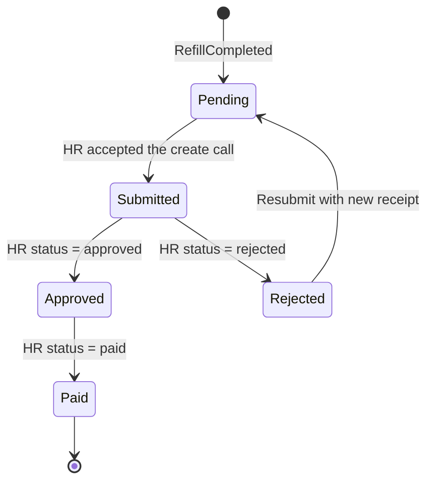

- `IsOverdue(now, 10 days)` is derived, not a state: `Status == Submitted && now - SubmittedAt > threshold`.
- `ApplyHrStatus` is **idempotent**. Applying the same status twice is a no-op, which matters because polling repeats.
- The idempotency key sent to HR is `Claim.Id` plus a resubmission counter.

---

## 6. Assignment engine ("choosing who buys")

### 6.1 Pipeline

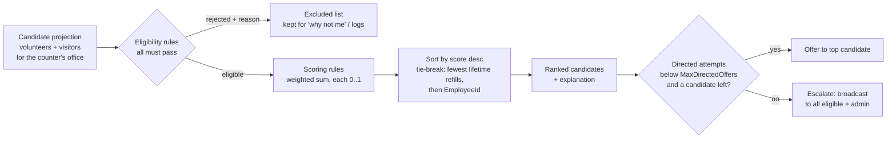

### 6.2 Contracts

```csharp
public sealed record Candidate(
    EmployeeId Id, OfficeId HomeOfficeId, bool IsVolunteer,
    Presence PresenceToday, Presence PresenceNextWorkday,          // AtOffice(officeId) | Remote | Holiday
    int RefillsLast90Days, DateTimeOffset? LastRefillAt, int LifetimeRefills,
    int UnpaidClaims, TimeSpan? OldestUnpaidClaimAge);

public sealed record AssignmentContext(
    Refill Refill, Office Office, DateOnly Today, DateTimeOffset Now, AssignmentOptions Options);

public interface IEligibilityRule
{
    string Name { get; }
    EligibilityVerdict Evaluate(Candidate c, AssignmentContext ctx);   // Eligible | Ineligible(reason)
}

public interface IScoringRule
{
    string Name { get; }
    double Score(Candidate c, AssignmentContext ctx);                  // normalised 0..1, higher = better pick
}

public sealed class AssignmentEngine(IEnumerable<IEligibilityRule> rules, IEnumerable<IScoringRule> scorers, IOptions<AssignmentOptions> opt)
{
    public AssignmentDecision Rank(IReadOnlyCollection<Candidate> candidates, AssignmentContext ctx)
    {
        var excluded = new List<(Candidate, string)>();
        var eligible = new List<Candidate>();
        foreach (var c in candidates)
        {
            var failed = rules.Select(r => (r, v: r.Evaluate(c, ctx))).FirstOrDefault(x => !x.v.IsEligible);
            if (failed.r is null) eligible.Add(c); else excluded.Add((c, $"{failed.r.Name}: {failed.v.Reason}"));
        }

        var ranked = eligible
            .Select(c => new RankedCandidate(c, scorers.Sum(s => opt.Value.WeightOf(s.Name) * s.Score(c, ctx)),
                                             scorers.ToDictionary(s => s.Name, s => s.Score(c, ctx))))
            .OrderByDescending(r => r.Total)
            .ThenBy(r => r.Candidate.LifetimeRefills)
            .ThenBy(r => r.Candidate.Id.Value)                         // deterministic, so tests are stable
            .ToList();

        return new AssignmentDecision(ranked, excluded);
    }
}
```

### 6.3 Default rules (each one is a class with its own tests)

| Type | Rule | Logic | Config |
|---|---|---|---|
| Eligibility | `MustBeVolunteer` | Has opted in as a volunteer | — |
| Eligibility | `MustServeCounterOffice` | Home office = counter office, **or** visiting the counter's office today or next working day and the office allows visitors | `Office.AllowVisitorsToVolunteer` |
| Eligibility | `MustBePresentSoon` | At the counter's office today **or** next working day. Holiday, remote and away at another office exclude | — |
| Eligibility | `MustNotHaveBeenAttempted` | Hasn't declined, timed out on, or missed the deadline for **this** refill | — |
| Eligibility | `UnpaidClaimsBelowCap` | `UnpaidClaims < cap`. Uses a count, not an amount, to avoid comparing currencies | `OutstandingClaimsCap = 2` |
| Scoring | `FewestRecentRefills` | `1 - refills90d / max(refills90d among eligible)` | weight `0.5` |
| Scoring | `LongestSinceLastRefill` | `min(daysSinceLast / 60, 1)`. Never refilled = 1 | weight `0.3` |
| Scoring | `InOfficeToday` | 1 if at the office today, 0.5 if only next working day | weight `0.2` |

**Presence resolution** (`PresenceResolver`): an explicit `Availability` entry for the date wins. Otherwise the employee's `DefaultOfficeDays` → `AtOffice(home)`, else `Remote`. Weekends and office holidays → not present.

**Why directed offers instead of only broadcasting:** with a broadcast, the same keen people always win, which is exactly the "few do most" problem. Directed offers spread the load. The broadcast fallback keeps it fast when the top picks can't help. Each offer includes the scoring explanation ("you've done 0 refills in 90 days") so it feels fair rather than arbitrary.

---

## 7. Budgeting

### 7.1 Formulas (per office, per budget month, always in the office currency)

```
Spent(o, m)        = Σ Spend entries − Σ negative Adjust entries for refunds
Reserved(o, m)     = Σ Reserve − Σ Release                        (open reservations only)
Remaining(o, m)    = Limit(o, m) − Spent(o, m) − Reserved(o, m)

On Commit:   if Remaining < office.TypicalMinPurchase → BudgetExhausted (refill → OnHold)
             reservation = Min(office.TypicalMaxPurchase, Remaining)
             → the buyer is told "spend up to {reservation}"
On Complete: Release(reservation); policy.Evaluate(actual, Remaining) → Spend(actual) [+ OverBudget flag]
On Expire / Cancel: Release(reservation)
```

### 7.2 Policy (strategy)

```csharp
public interface IBudgetPolicy
{
    SpendDecision Evaluate(Money actual, Money remainingAfterRelease);   // Accept | AcceptWithWarning(OverBudget) | RequiresApproval | Reject
}
public sealed class SoftCapBudgetPolicy : IBudgetPolicy   // default: never strand a volunteer who already paid
{
    public SpendDecision Evaluate(Money actual, Money remaining) =>
        actual.IsLessThan(remaining) || actual == remaining ? SpendDecision.Accept : SpendDecision.AcceptWithWarning("OverBudget");
}
```

### 7.3 Commit with budget reservation (one transaction)

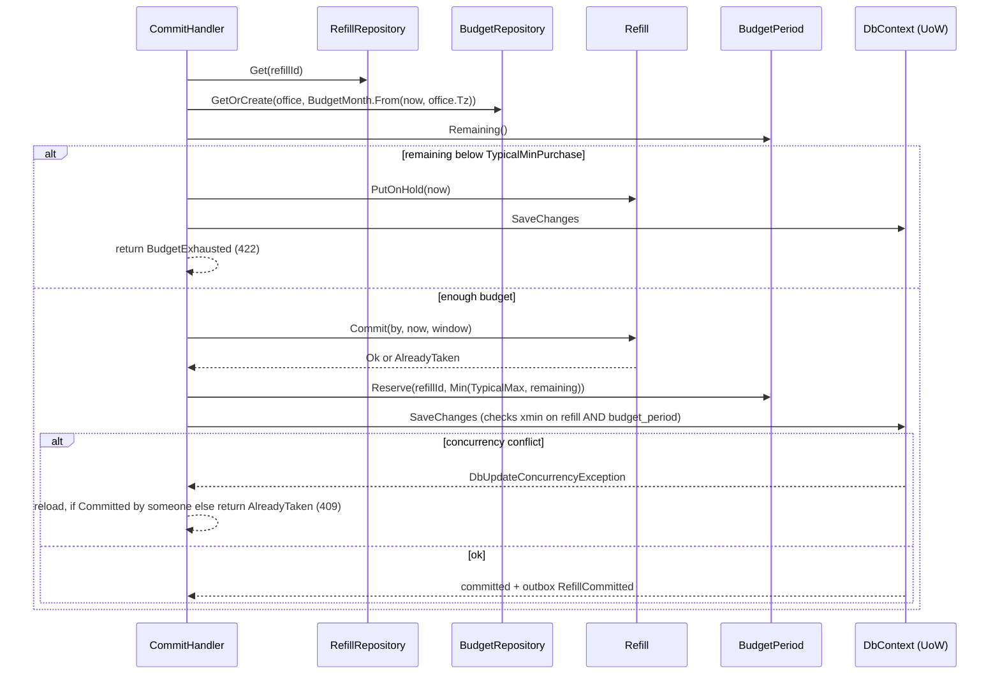

The `BudgetPeriod` row also carries `xmin`, so two counters in the same office can't over-reserve at the same moment.

---

## 8. Currencies and the monthly report

### 8.1 Rules

1. Every purchase is recorded in the **counter's office currency** (the receipt currency), whatever the buyer's payroll currency.
2. The budget is checked in that same currency. **No FX in the budget check.**
3. The claim is sent to HR in the receipt currency. HR converts to payroll currency (given in the brief). If HR returns the paid amount and currency, we store it for information only.
4. The consolidated report converts **each office's monthly total once**, using a monthly rate saved in the report (`fx_rates`, `monthly_reports.rates_json`). Summing in native currency first, then converting once, minimises rounding drift.

### 8.2 Report computation

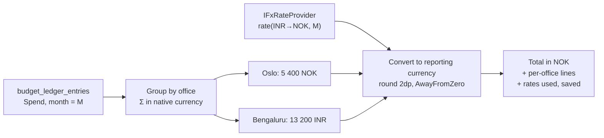

**Worked example (illustrative rate, not a real quote):** rate INR→NOK = 0.1250.
Oslo 5 400.00 NOK + Bengaluru 13 200 × 0.1250 = 1 650.00 NOK → **total 7 050.00 NOK**.
Report also includes, per office: limit, spent, remaining, % used, number of refills, average purchase, median time from empty to refilled, top items (if captured), unpaid claims and their age.

---

## 9. Application layer

### 9.1 Handler abstractions (no MediatR)

```csharp
public interface ICommand<TResult>;
public interface ICommandHandler<in TCommand, TResult> where TCommand : ICommand<TResult>
{
    Task<Result<TResult>> Handle(TCommand command, CancellationToken ct);
}
// Decorators registered with Scrutor, outermost first: Logging → Validation → Transaction(+outbox flush) → Handler
```

### 9.2 Use cases

| Slice | Type | Input | Key steps |
|---|---|---|---|
| `ReportEmpty` | Cmd | counterId, reporterId | Return the existing active refill if there is one. Else `Refill.Report` → save → call `OfferNext` |
| `OfferNext` | Cmd (internal) | refillId | Check budget (`OnHold`?) → load candidates → `AssignmentEngine.Rank` → `Offer` top candidate or `Escalate` |
| `CommitToRefill` | Cmd | refillId, employeeId | §7.3 |
| `DeclineRefill` | Cmd | refillId, employeeId | `Decline` → `OfferNext` |
| `CompleteRefill` | Cmd | refillId, buyerId, amount, receipt stream, items? | Store receipt → `Refill.Complete` → `BudgetPeriod.Release` + `Spend` → `Claim.Create` → outbox `SubmitClaim` |
| `CancelRefill` | Cmd | refillId, adminId, reason | `Cancel` → release reservation |
| `SweepDeadlines` | Cmd (job) | now | For each due refill (one transaction each, stop on a concurrency conflict): `ExpireDeadline` → release if committed → `OfferNext`. Send 50% reminders |
| `SetAvailability` | Cmd | employeeId, from, to, kind, visitingOffice? | Validate there are no overlapping ranges |
| `SetMonthlyLimit` | Cmd | officeId, month, amount | Admin only. Then `Resume` any `OnHold` refills of that office |
| `SubmitClaim` | Cmd (outbox) | claimId | `IHrGateway.CreateClaim` → `MarkSubmitted` |
| `SyncClaimStatus` | Cmd (job) | — | Poll `Submitted`/`Approved` → `ApplyHrStatus`. Flag overdue → notify the admin |
| `HandleChatEvent` | Cmd | raw chat event | Parse → dispatch one of the commands above |
| `GetBudgetStatus` | Query | officeId, month | Limit, spent, reserved, remaining |
| `GetMonthlyReport` | Query | month, reportingCurrency | §8 |
| `ListRefills` / `GetRefill` | Query | filters / id | Read models for the UI (timeline from `refill_events`) |

### 9.3 Domain events → handlers (in-process, during SaveChanges, inside the same transaction)

**Convention:** use-case handlers orchestrate aggregates (reserve, release, spend, create the claim), so each use case reads top to bottom. Domain event handlers **only produce side effects**, by writing to the outbox.

| Event | Handlers (`RefillNotifications` / `ClaimNotifications`) |
|---|---|
| `RefillOffered` | Outbox → chat DM with Accept/Decline buttons and the "why you" text |
| `RefillCommitted` | Outbox → channel post "X is on it" |
| `OfferExpired` / `PurchaseReminderDue` / `PurchaseDeadlineMissed` | Outbox → DM to the (previous) assignee |
| `RefillEscalated` | Outbox → channel broadcast with an Accept button + message to office admins |
| `RefillPutOnHold` | Outbox → message to office admins |
| `RefillCompleted` / `RefillCancelled` | Outbox → channel post |
| `ClaimReadyForSubmission` | Outbox → `SubmitClaimToHr` |
| `ClaimStatusChanged` | Outbox → DM to the buyer |
| `ClaimOverdue` / `OverBudgetSpendRecorded` | Outbox → message to office admins |

---

## 10. Ports (outbound interfaces)

```csharp
public abstract record ChatAudience            // Direct(EmployeeId) | OfficeChannel(OfficeId) | OfficeAdmins(OfficeId)
public sealed record ChatMessage(string Text, IReadOnlyList<ChatAction> Actions);   // ChatAction(Label, Value) = a button

public interface IChatGateway
{
    Task Send(ChatAudience audience, ChatMessage message, CancellationToken ct);
}

public interface IHrGateway
{
    Task<string> CreateClaim(HrClaimRequest request, string idempotencyKey, CancellationToken ct);   // returns HR's claim id
    Task<HrClaimStatusReport> GetClaimStatus(string hrClaimId, CancellationToken ct);              // already mapped to our ClaimStatus
}
public sealed record HrClaimRequest(string HrEmployeeId, decimal Amount, string Currency, string Description, byte[] ReceiptImage, string ReceiptContentType);

public interface IFxRateProvider { Task<decimal?> GetMonthlyRate(Currency from, Currency to, BudgetMonth month, CancellationToken ct); }
public interface IReceiptStore  { Task<string> Save(byte[] content, string contentType, CancellationToken ct); Task<StoredReceipt> Get(string key, CancellationToken ct); }
```

The candidate snapshot is built by `CandidateBuilder` (application service) from the repositories, so the I/O stays out of the pure `AssignmentEngine`.

**Simulated adapters (demo and tests):**
- `SimulatedChatGateway`: writes to a `sim_chat_messages` table (or in memory for unit tests). The dev UI renders it and posts button clicks back to the chat webhook.
- `SimulatedHrGateway`: stores claims and returns `hr-{n}`. Honours idempotency keys (same key → same id). Dev endpoints approve, reject or pay. Optional auto-approve after a random delay of 1–10 simulated days.

---

## 11. Persistence (PostgreSQL)

### 11.1 ERD

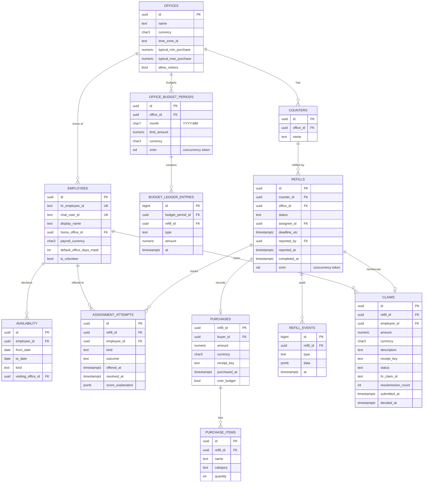

Supporting tables: `outbox_messages(id, type, payload jsonb, occurred_at, attempts, next_attempt_at, processed_at, last_error)`, `fx_rates(month, from_ccy, to_ccy, rate numeric(18,8))`, `monthly_reports(month, reporting_ccy, data jsonb, rates jsonb, generated_at)`.

### 11.2 Key DDL

```sql
-- At most ONE active refill per counter: prevents duplicate buying at the database level
CREATE UNIQUE INDEX ux_refills_one_active_per_counter
    ON refills (counter_id)
    WHERE status IN ('Open','Offered','Escalated','OnHold','Committed');

-- One budget row per office per month
CREATE UNIQUE INDEX ux_budget_period ON office_budget_periods (office_id, month);

-- Sweeper scans only due rows
CREATE INDEX ix_refills_due ON refills (deadline_utc) WHERE status IN ('Offered','Committed');

-- Outbox polling
CREATE INDEX ix_outbox_due ON outbox_messages (next_attempt_at) WHERE processed_at IS NULL;

-- Money sanity
ALTER TABLE purchases ADD CONSTRAINT ck_purchase_positive CHECK (amount > 0);
```

### 11.3 EF Core notes

*As built in P2 (`src/SnackCounter.Infrastructure/Persistence/`):*

- A shadow property `b.Property<uint>("xmin").IsRowVersion()` on `Refill`, `BudgetPeriod` and `Claim` maps to PostgreSQL's system column **`xmin`**: optimistic concurrency with no extra column.
- **The aggregate is the unit of concurrency.** If only a child row changed (a new ledger entry or assignment attempt), `EfUnitOfWork` marks the root `Modified`, so EF still issues `UPDATE … WHERE xmin = @original`. Without this, two concurrent reservations on one budget would both succeed (there is an integration test that proves it, and a mutation check showed the test fails without the guard).
- Strongly typed ids, `Currency` and `BudgetMonth` via convention-wide value converters. `Money` is a `ComplexProperty` (`*_amount`, `*_currency` columns). Enums are stored as strings.
- `Purchase` is a `jsonb` column (written once, read whole). The buyer is also `assignee_id` once completed, so queries never look inside the JSON.
- Children (`assignment_attempts`, `budget_ledger_entries`) are mapped through the aggregates' private backing fields with `AutoInclude()`.
- `EfUnitOfWork.SaveChanges` dispatches domain events until none are left (handlers write outbox rows), then calls one `SaveChangesAsync`, which is **one transaction**. It translates `DbUpdateConcurrencyException` into `ConcurrencyConflictException`, and a unique violation on `ux_refills_one_active_per_counter` into `DuplicateActiveRefillException`, so handlers never reference EF or Npgsql.
- Opening a month's budget is an idempotent `INSERT … ON CONFLICT (office_id, month) DO NOTHING`. Concurrent first requests of a month all succeed, and one row results.
- Outbox payloads are stored as `{"type", "data"}` jsonb, deserialised only into an allow-list of payload types.
- **Multiple instances:** jobs do not use `SKIP LOCKED`. Two instances can pick up the same due refill or outbox row. The `xmin` check makes the loser's write fail cleanly, HR submission is idempotent by key, and the worst case is a duplicate chat message. A single instance is plenty at this scale; adding `SKIP LOCKED` inside an explicit transaction is the upgrade path.
- Domain concessions to EF: private parameterless constructors marked `// EF Core`, plus explicit mapping of getter-only properties.

---

## 12. Concurrency scenarios

### 12.1 Two volunteers press Accept at once (escalated broadcast)

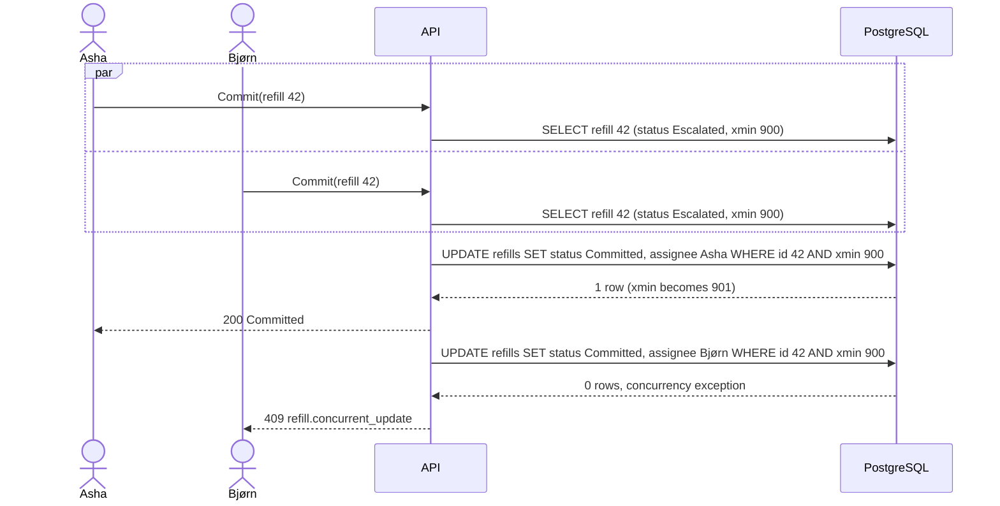

If Bjørn's request reads the row after Asha's commit instead, the domain check answers first with `409 refill.already_taken`. Either way it's exactly one 200, which `ApiTests.Ten_volunteers_racing_to_accept_exactly_one_wins` verifies on real PostgreSQL.

### 12.2 Sweeper expires a deadline while the buyer uploads the receipt

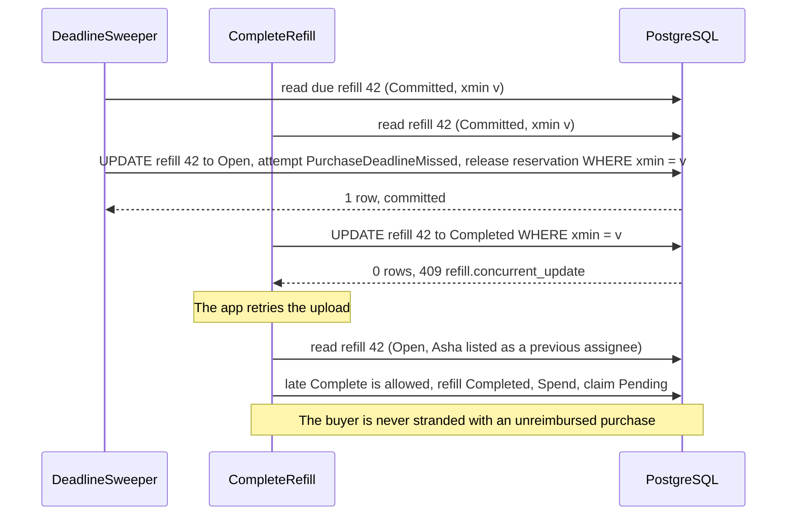

---

## 13. API (Minimal APIs, `/api`)

| Method | Route | Role | Body / result | Errors |
|---|---|---|---|---|
| POST | `/counters/{counterId}/refills` | any employee | → `201` new refill, or `200` existing one | 404 |
| GET | `/refills?officeId=&status=` | any | list | — |
| GET | `/refills/{id}` | any | detail + timeline + attempts | 404 |
| POST | `/refills/{id}/commit` | volunteer | → refill (with `spendUpTo`) | 409 AlreadyTaken / InvalidTransition, 422 BudgetExhausted |
| POST | `/refills/{id}/decline` | volunteer | → 204 | 409 |
| POST | `/refills/{id}/complete` | assignee | multipart: `amount`, `currency`, `receipt`, `items[]` | 400, 409, 413 |
| POST | `/refills/{id}/cancel` | office admin | `{ reason }` | 403, 409 |
| GET | `/offices/{id}/budget?month=YYYY-MM` | any | limit / spent / reserved / remaining | 404 |
| PUT | `/offices/{id}/budget/{month}` | office admin | `{ amount }` | 400, 403 |
| GET / PUT | `/me/availability` | self | ranges | 400 overlapping |
| GET | `/me/claims` | self | claims with status and age | — |
| GET | `/reports/monthly?month=&currency=` | management | consolidated report | 404 |
| POST | `/integrations/chat/events` | signed webhook | chat command / button | 401 bad signature |
| POST | `/integrations/hr/claim-status` | signed webhook (optional) | status push | 401 |
| *dev* | `/dev/chat/messages`, `/dev/hr/claims/{id}/{approve\|reject\|pay}`, `/dev/clock/advance`, `/dev/act-as` | Development only | demo controls | — |

All errors use RFC 7807 ProblemDetails with an `errorCode` extension (`refill.already_taken`, `budget.exhausted`, …) so the UI and chat can show friendly text.

---

## 14. Frontend (Angular 20)

### 14.1 Structure

*As built in P3 (Angular 20.3, zoneless):*

```
web/snack-counter-ui/src/app/
├─ core/
│  ├─ api.ts              typed client for every endpoint (Promise-based, for async/await with signals)
│  ├─ models.ts           TypeScript mirrors of the API JSON
│  ├─ session.ts          ActingAs (dependency-free, read by the interceptor) + SessionStore (people, me)
│  ├─ overview.store.ts   signal store for the dashboard (offices, budgets, boxes, recent refills)
│  ├─ clock.ts            "now" in step with the server, so countdowns follow the demo clock
│  ├─ interceptors.ts     X-Employee-Id header; problem details → friendly toast by errorCode
│  ├─ poll.ts             pollWhileAlive(): refresh every few seconds, paused while the tab is hidden
│  └─ toast.ts, format.ts
├─ shared/
│  ├─ snack-box.ts        the box visual: full / empty / filling / on hold
│  ├─ box-status.ts       box + "It's your turn" / "Lars is on it" + the right actions for the viewer
│  ├─ budget-strip.ts     spent / set aside / left, with overspend in berry
│  └─ status.ts           status vocabulary (refill, claim, attempt outcome) in user language
├─ features/
│  ├─ dashboard/          both offices side by side, inline budget editing for admins, recent refills
│  ├─ refills/            refill page: history timeline, receipt upload (incl. late buyer), admin cancel
│  ├─ me/                 availability (holiday, remote, visiting) and my claims with resubmit
│  ├─ report/             monthly consolidated report, total in NOK or INR
│  └─ demo/               simulated chat feed with clickable buttons, HR inbox, clock, run jobs
├─ app.routes.ts          lazy loadComponent per page; refill id bound with withComponentInputBinding
└─ app.config.ts          provideZonelessChangeDetection, provideRouter, provideHttpClient(withInterceptors)
```

Conventions: standalone components, `ChangeDetectionStrategy.OnPush`, control flow (`@if`, `@for`), `input()`/`output()` signals, signal stores instead of NgRx. Dev server proxies `/api` to `localhost:5252`, so no CORS during development. `?as=<employee id>` opens the app as a specific person, for demo links.

### 14.2 Component tree and data flow

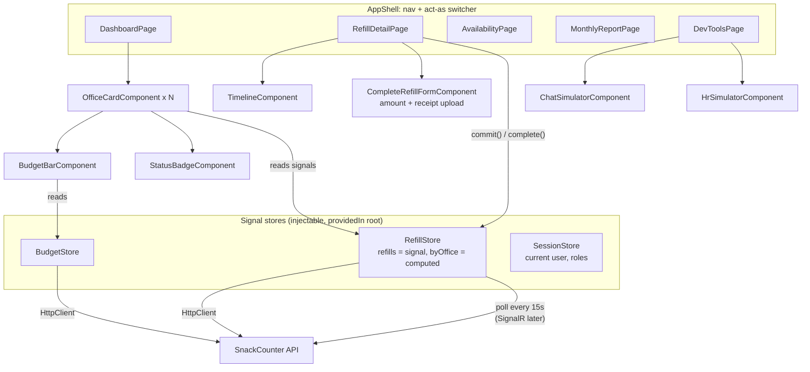

### 14.3 Store pattern (example)

```ts
@Injectable({ providedIn: 'root' })
export class RefillStore {
  private api = inject(RefillApi);
  private readonly _refills = signal<RefillDto[]>([]);
  readonly loading = signal(false);
  readonly refills = this._refills.asReadonly();
  readonly activeByOffice = computed(() =>
    Object.groupBy(this._refills().filter(r => r.status !== 'Completed' && r.status !== 'Cancelled'), r => r.officeId));

  async load(officeId?: string) { this.loading.set(true); try { this._refills.set(await firstValueFrom(this.api.list(officeId))); } finally { this.loading.set(false); } }
  async commit(id: string) { const updated = await firstValueFrom(this.api.commit(id)); this.upsert(updated); }   // a 409 is handled by the interceptor → toast "Already taken by X"
  private upsert(r: RefillDto) { this._refills.update(list => [...list.filter(x => x.id !== r.id), r]); }
}
```

---

## 15. Configuration

```jsonc
// appsettings.json (office-specific values live in the DB, not here)
{
  "ConnectionStrings": { "Snack": "Host=localhost;Database=snack;Username=snack;Password=snack" },
  "Assignment": {
    "OfferTtl": "02:00:00",
    "PurchaseWindow": "1.00:00:00",
    "ReminderAtFraction": 0.5,
    "MaxDirectedOffers": 3,
    "OutstandingClaimsCap": 2,
    "Weights": { "FewestRecentRefills": 0.5, "LongestSinceLastRefill": 0.3, "InOfficeToday": 0.2 }
  },
  "Reimbursement": { "OverdueAfter": "10.00:00:00", "PollInterval": "01:00:00" },
  "Reporting": { "Currency": "NOK", "SendAtLocal": "08:00", "TimeZone": "Europe/Oslo" },
  "Integrations": { "Chat": { "Mode": "Simulated" }, "Hr": { "Mode": "Simulated", "BaseUrl": "" } }
}
```

Seed data: Oslo (NOK, `Europe/Oslo`, min 300, max 1 200, budget 6 000), Bengaluru (INR, `Asia/Kolkata`, min 500, max 3 000, budget 15 000), 15 + 20 volunteers with mixed office days.

---

## 16. Testing strategy

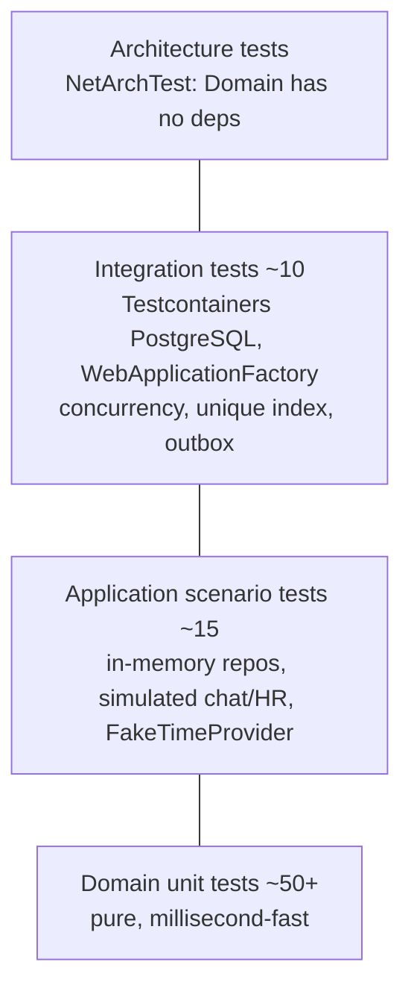

### 16.1 Rule → test map

| Rule | Test | Level |
|---|---|---|
| Two people can't both commit | `Commit_WhenCommittedByAnother_ReturnsAlreadyTaken` | Domain |
| | `TwoConcurrentCommits_OnlyOneSucceeds` (`Task.WhenAll` on 2 DbContexts) | Integration |
| | `Commit_IsIdempotentForSameAssignee` | Domain |
| No duplicate refills | `SecondEmptyReport_ReturnsExistingRefill` | Integration (unique index) |
| Unfinished refill is handed on | `UnansweredOffer_AfterTtl_IsOfferedToNextCandidate` | Application + FakeTimeProvider |
| | `MissedPurchaseDeadline_ReleasesReservation_AndReoffers` | Application |
| | `AllDirectedOffersFail_EscalatesToBroadcast` | Application |
| | `PreviousAssignee_IsNotReofferedSameRefill` | Domain |
| | `LateCompletion_ByPreviousAssignee_IsAccepted` | Domain |
| Who buys | `ExcludesVolunteersOnHolidayOrRemote` | Domain |
| | `VisitorIsEligibleAtVisitedOffice_NotAtHomeOffice` | Domain |
| | `PrefersFewestRecentRefills_TieBreakIsDeterministic` | Domain |
| | `SkipsVolunteerWithUnpaidClaimsAtCap` | Domain |
| Budget | `Remaining_EqualsLimitMinusSpentMinusOpenReservations` | Domain |
| | `Commit_BelowMinimumBudget_PutsRefillOnHold` | Application |
| | `Reservation_IsCappedAtRemaining` | Domain |
| | `OverspendUnderSoftCap_IsRecordedAndFlagged` | Domain |
| | `SpendIsChargedToCounterOffice_InOfficeCurrency_RegardlessOfPayroll` | Application |
| | `BudgetMonth_UsesOfficeTimeZone_AtMonthBoundary` | Domain |
| Currency | `AddingDifferentCurrencies_Throws` | Domain |
| | `MonthlyReport_ConvertsPerOfficeTotalsWithSavedRate` (6 000 NOK + 15 000 INR) | Application |
| Reimbursement | `ClaimSubmittedOnce_WhenOutboxRetries` (idempotency key) | Application |
| | `Claim_SubmittedOver10DaysAgo_IsOverdue` | Domain |
| | `ApplyHrStatus_IsIdempotent` | Domain |

### 16.2 Example scenario test

```csharp
[Fact]
public async Task UnansweredOffer_AfterTtl_IsOfferedToNextCandidate()
{
    var clock = new FakeTimeProvider(new DateTimeOffset(2026, 11, 17, 9, 0, 0, TimeSpan.FromHours(1)));
    var app = TestApp.Create(clock)                               // in-memory repos + simulated chat
        .WithOffice(Oslo).WithVolunteers(("asha", refills90d: 0), ("bjorn", refills90d: 2));

    var refill = await app.Send(new ReportEmpty(Oslo.Counter1, reporter: "kari"));
    app.Chat.LastDirectMessageTo("asha").ShouldContainAction("accept");

    clock.Advance(TimeSpan.FromHours(2) + TimeSpan.FromSeconds(1));
    await app.Send(new SweepDeadlines());

    var r = await app.Refills.Get(refill.Id);
    r.Status.ShouldBe(RefillStatus.Offered);
    r.AssigneeId.ShouldBe(app.Employee("bjorn"));
    r.Attempts.Single(a => a.EmployeeId == app.Employee("asha")).Outcome.ShouldBe(AttemptOutcome.OfferExpired);
}
```

---

## 17. Build order (maps to the plan's phases)

1. `Money`, `Currency`, `BudgetMonth` + tests
2. `Refill` + transition table + tests (every row of §4.2)
3. `AssignmentEngine` + 5 rules + 3 scorers + tests
4. `BudgetPeriod` + `SoftCapBudgetPolicy` + tests
5. `Claim` + tests
6. Application handlers + in-memory repos + simulated gateways + scenario tests (FakeTimeProvider)
7. EF Core mapping, migrations, indices, interceptor + outbox, Testcontainers tests
8. Minimal API endpoints + ProblemDetails mapping + dev endpoints
9. Hosted jobs
10. Angular: shell → dashboard → refill detail → dev tools → availability → report
11. docker-compose + seed + README
