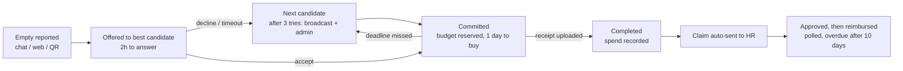

# Snack Counter Automation — Design Document

## What "automate" means here
The real problem isn't buying snacks. It's that **nobody owns the refill**, **nobody can see who is already on it**, **the work and the float fall on a few people**, and **nobody tracks spend**. The system therefore automates four things: **ownership** (exactly one person is responsible at any moment, with a deadline), **exclusivity** (one active refill per box), **fairness** (rotating offers, fast automatic claims) and **visibility** (a budget ledger and a monthly report). Buying the snacks stays human.

## How a refill moves from "empty" to "reimbursed"

1. **Report:** anyone posts `/snacks empty`, clicks in the web app, or scans the QR code on the box. If a refill is already active, they're told who is on it.
2. **Choose:** the system ranks volunteers who are **at that office today or tomorrow** (holiday, remote and visiting are taken into account), **haven't refilled recently**, and **don't have unpaid claims piling up**. It sends a chat DM to the top one, with Accept and Decline buttons.
3. **Commit:** the first valid Accept wins. The budget is reserved and the volunteer is told "spend up to 1 200 NOK". The office channel sees "Asha is on it".
4. **Buy and upload:** the volunteer enters the amount and photographs the receipt. The spend is recorded against that office's month.
5. **Reimburse:** the claim (amount, currency, description, receipt, employee ID) is sent to HR automatically and reliably. Its status is polled and the volunteer is notified at each step.

Refilling the box and paying the volunteer are **two separate lifecycles** (`Refill` and `Claim`). The box can be refilled again while HR is still approving last week's claim.

## Main parts and the data each keeps

| Part | Keeps |
|---|---|
| Organisation | Offices (currency, time zone, typical purchase range), counters, employees (HR id, chat id, home office, payroll currency), availability |
| Refills | Refill status, assignee, deadline, every offer attempt and its outcome, purchase (amount, receipt, optional items), audit events |
| Assignment | No data. Stateless rules and scorers over a candidate snapshot |
| Budgeting | Monthly limit per office + append-only ledger (reserve / release / spend / adjust) in the office currency |
| Reimbursement | Claims: amount, currency, HR claim id, status, submitted and decided timestamps |
| Reporting | Monthly FX rates and generated report snapshots |
| Integrations | Outbox of pending chat messages and HR submissions. Simulated chat and HR adapters |

Built as one .NET 10 service (domain core with no I/O, one folder per use case, adapters for chat and HR), PostgreSQL, and an Angular 20 web app.

## How the listed problems are prevented

| Problem | Prevention |
|---|---|
| Box empty for days | Always exactly one owner, with a 2-hour offer TTL and a 1-day purchase deadline. A job reassigns automatically, then broadcasts and escalates to the office admin |
| Two people buy the same day | The database allows **one active refill per box** (partial unique index). Commit uses optimistic concurrency: the first Accept wins, the second gets "already taken by Asha" |
| A few do most and wait weeks | Offers go to whoever has done the **fewest recent refills**. Anyone with ≥ 2 unpaid claims is skipped. Claims are filed **automatically at upload**, and anything over 10 days is flagged to the admin |
| Unknown spend and consumption | Every krone and rupee is in the ledger. On the 1st of each month management gets one report: per office in local currency plus a consolidated total at a saved monthly FX rate. Time from refill to empty and optional item lists show what actually gets eaten |

**Money rules:** each office's budget and purchases are in its own currency (Oslo NOK, Bengaluru INR), even when a visitor buys. Currencies are never added together, and conversion happens only in the report. A visiting Bengaluru employee buying in Oslo uses Oslo's budget, files the claim in NOK, and HR pays them in INR. Budget months follow the office's local time zone.

## Trade-offs

- **Directed offers vs first-come broadcast:** directed offers are fairer and avoid the "everyone waits" problem. The cost is a short delay if the first picks don't answer, so we fall back to broadcast after 3 tries.
- **Soft budget cap:** we block *new* refills when the budget is nearly gone, but an overspend that has already happened is still recorded and reimbursed (and flagged). Refusing to pay a volunteer for snacks they've already bought would undo the goodwill the process runs on.
- **Manual amount entry instead of OCR:** simpler and reliable. HR checks the receipt anyway.
- **Polling HR instead of waiting for webhooks:** works with any HR API. A webhook adapter can be added without touching the core.
- **A modular monolith instead of microservices:** two boxes and about 30 refills a month don't justify distributed transactions. Module boundaries leave room to split later.
- **Availability is self-declared** (plus default office days) rather than read from calendars. Less magic, but no calendar integration to build or secure.

## What we deliberately won't build
Real chat and HR integrations (simulated behind interfaces), receipt OCR, item-level inventory or sensors, our own login (company SSO), a mobile app, snack voting, microservices or a message broker. Worth raising with the business: **a company card per office would remove reimbursement entirely.** The design supports that as a payment-method option.
